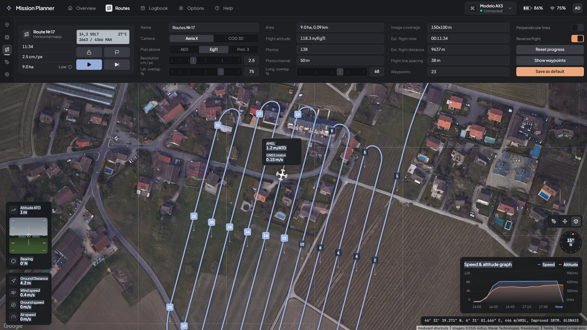
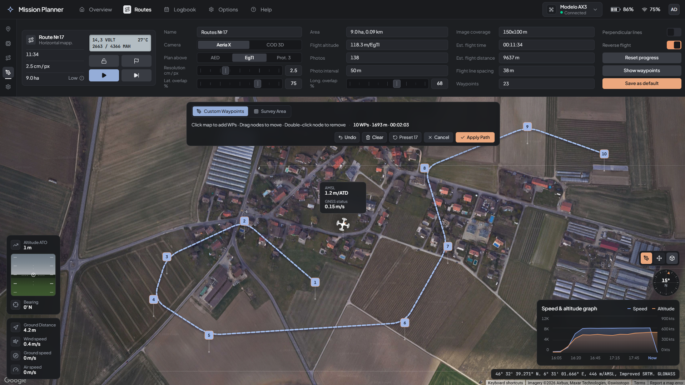
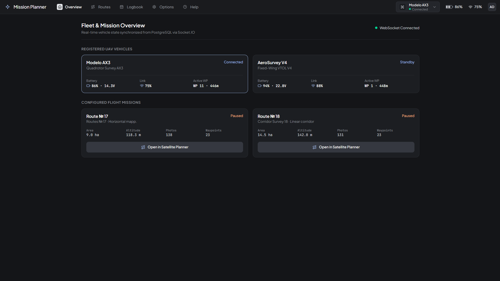
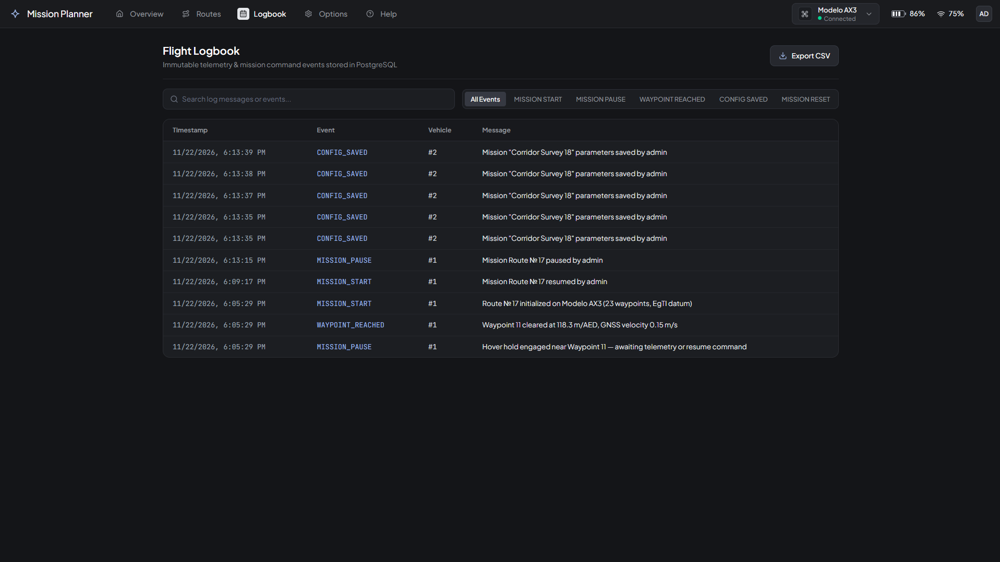
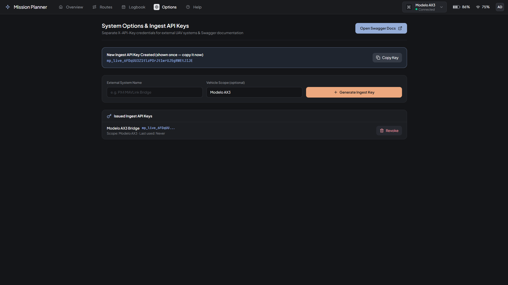
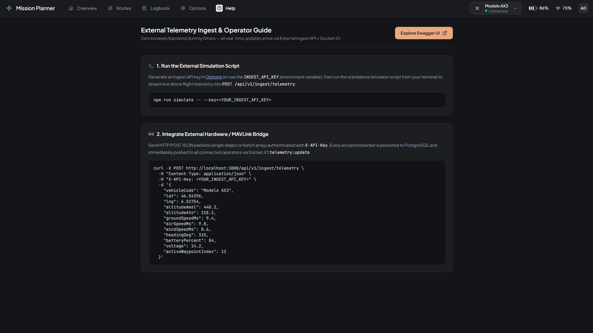
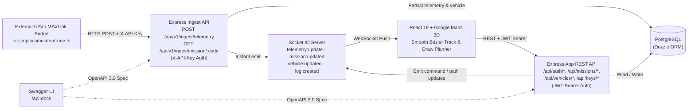

<div align="center">

# Mission Planner

**Production-grade UAV Ground Control Station (GCS) with 3D Satellite Mapping, Interactive Flight Path Planning, Real-Time Socket.IO Telemetry, and External Ingest API.**

<p>
  
  
  
  
</p>
<p>
  
  
  
  
</p>

</div>

---

## Interface Gallery

<p>
  
</p>

<table>
  <tr>
    <td width="33.33%" valign="top">
      
      <p align="center"><sub><b>Draw Flight Path</b> — Interactive Custom Waypoints &amp; Survey Area Grid</sub></p>
    </td>
    <td width="33.33%" valign="top">
      
      <p align="center"><sub><b>Fleet &amp; Mission Overview</b> — Multi-vehicle status &amp; mission sync</sub></p>
    </td>
    <td width="33.33%" valign="top">
      
      <p align="center"><sub><b>Flight Logbook</b> — Searchable PostgreSQL event ledger &amp; CSV export</sub></p>
    </td>
  </tr>
  <tr>
    <td width="33.33%" valign="top">
      
      <p align="center"><sub><b>Options &amp; API Keys</b> — Scoped external ingest credentials</sub></p>
    </td>
    <td width="33.33%" valign="top">
      
      <p align="center"><sub><b>Operator Ingest Guide</b> — CLI simulator &amp; MAVLink cURL bridge</sub></p>
    </td>
    <td width="33.33%" valign="middle">
      <div align="center">
        <h4>Swagger / OpenAPI 3.0</h4>
        <p><sub>Interactive API documentation served at <code>/api-docs</code> &amp; <code>/api-docs.json</code> for external drone telemetry integration, mission sync, and operator endpoints.</sub></p>
        <code>POST /api/v1/ingest/telemetry</code><br/><br/>
        <code>GET /api/v1/ingest/mission/{vehicleCode}</code>
      </div>
    </td>
  </tr>
</table>

---

## Project Structure

```text
mission-planner/
├── docs/                                # README gallery screenshots
│   ├── screen_mission_planner_main.png
│   ├── screen_mission_planner_draw_path.png
│   ├── screen_mission_planner_overview.png
│   ├── screen_mission_planner_logbook.png
│   ├── screen_mission_planner_options.png
│   └── screen_mission_planner_help.png
├── scripts/
│   └── simulate-drone.ts                # Standalone external UAV telemetry simulator (HTTP ingest)
├── src/
│   ├── components/
│   │   ├── AuthScreen.tsx               # Operator login & registration (JWT auth)
│   │   ├── DrawPathPlannerBar.tsx       # Floating Draw Mode toolbar (Custom Waypoints & Survey Area)
│   │   ├── MissionControlRibbon.tsx     # Photogrammetry controls, LCD battery telemetry & keypad
│   │   ├── SatelliteMapViewport.tsx     # Google Maps 3D Satellite + smooth SVG track & drag handles
│   │   ├── SecondaryViews.tsx           # Overview, Logbook (CSV), Options (API Keys), Help views
│   │   ├── TelemetryHudOverlays.tsx     # FPV artificial horizon, compass rose & Speed/Altitude chart
│   │   └── TopNavBar.tsx                # Navigation bar, vehicle selector & live link indicators
│   ├── db/
│   │   ├── index.ts                     # PostgreSQL pg.Pool & Drizzle client (separated PG* params)
│   │   ├── schema.ts                    # Drizzle tables: users, ingest_api_keys, vehicles, missions, telemetry_points, flight_logs
│   │   └── seed.ts                      # Idempotent initial fleet/mission/history bootstrapper
│   ├── server/
│   │   ├── auth.ts                      # Separated auth: scrypt + JWT (app) & SHA-256 X-API-Key (ingest)
│   │   └── swagger.ts                   # OpenAPI 3.0.3 specification for /api-docs
│   ├── services/
│   │   ├── api.ts                       # Typed REST client (in-memory JWT token handling)
│   │   └── socket.ts                    # Socket.IO client wrapper for real-time telemetry & events
│   ├── shared/
│   │   └── flightTrack.ts               # Metric Bézier U-turn curves, filleted custom paths & polygon survey gridder
│   ├── types/
│   │   └── mission.ts                   # Shared TypeScript domain interfaces
│   ├── App.tsx                          # Root state orchestration & Socket.IO synchronization
│   ├── index.css                        # Tailwind CSS v4 theme tokens & typography
│   └── main.tsx                         # React 19 entry point
├── server.ts                            # Express + Socket.IO + Vite/dist unified server entry
├── drizzle.config.ts                    # Drizzle Kit configuration (separated DB parameters)
├── vite.config.ts                       # Vite bundler configuration
├── tsconfig.json                        # Strict TypeScript compiler configuration
├── package.json                         # Scripts & dependencies
├── .env.example                         # Environment variable template (no secrets)
└── .gitignore                           # Excludes .env*, dist, node_modules, public/assets/aistudio
```

---

## Apps System Architecture

Mission Planner strictly separates **Operator App Authentication**, **External Telemetry Ingest Authentication**, and **Real-Time Broadcast**:

- **Zero Fake/Dummy Loops**: Neither the browser nor the backend (`server.ts`) generates synthetic telemetry timers. All live flight state updates originate exclusively from `POST /api/v1/ingest/telemetry` (from real UAV bridges or the standalone CLI script `scripts/simulate-drone.ts`) or explicit operator commands.
- **Separated Auth Layers**:
  - **Operator App Auth**: Email/password (`scrypt` salted hashes) issuing short-lived `JWT` Bearer tokens for dashboard access, mission editing, and Socket.IO handshake.
  - **External Ingest Auth**: Scoped `X-API-Key` / `Authorization: ApiKey <key>` validated via SHA-256 hash lookup in `ingest_api_keys` (or optional `INGEST_API_KEY` env secret via `timingSafeEqual`).



### Flight Path Geometry Engine (`src/shared/flightTrack.ts`)
- **Survey Grids (`Horizontal mapp.`)**: Projects parallel survey rows into a local metric tangent plane and connects alternating legs with $C^1$-continuous cubic Bézier 180° semicircular U-turns.
- **Interactive Draw Path Planner**:
  - **Custom Waypoints**: Click to place waypoints, drag handles in 2D or 3D elevated view, double-click to remove, with smooth quadratic Bézier corner fillets.
  - **Survey Area Polygon**: Click field boundary corners (`A, B, C...`) to calculate polygon area (`ha`/`km²`) via Shoelace formula and generate an oriented serpentine grid respecting *Flight line spacing*, *Perpendicular lines*, and *Reverse flight*.

---

## Tech Stack

| Layer | Technology | Purpose |
| :--- | :--- | :--- |
| **Frontend UI** | React 19, TypeScript, Tailwind CSS v4, Lucide Icons | Dark-graphite GCS workspace, HUD overlays, responsive controls |
| **Satellite Map & Pathing** | `@vis.gl/react-google-maps`, Google Maps JS API, Custom `OverlayView` + SVG | 3D tilted (`45°`, `315°` NW) & 2D satellite view, Bézier flight tracks, drag-to-edit nodes |
| **Real-Time Transport** | Socket.IO (`socket.io` / `socket.io-client`) | Instant bi-directional sync (`telemetry:update`, `mission:updated`, `log:created`) |
| **Backend Server** | Node.js 22, Express 4, Zod | Unified HTTP + WebSocket server, request validation, rate limiting, security headers |
| **Database & ORM** | PostgreSQL, `pg`, Drizzle ORM, Drizzle Kit | Relational persistence using separated `PGHOST` / `PGPORT` / `PGDATABASE` / `PGUSER` / `PGPASSWORD` |
| **Authentication** | `jsonwebtoken`, Node `crypto` (`scrypt` & `sha256`) | Separated Operator JWT sessions and SHA-256 hashed `X-API-Key` credentials |
| **API Documentation** | `swagger-ui-express` | Interactive OpenAPI 3.0.3 portal at `/api-docs` and `/api-docs.json` |

---

## How to Build

### 1. Prerequisites
- **Node.js** `>= 22.x` (native TypeScript execution supported in production via `node server.ts`)
- **PostgreSQL** instance (e.g., Supabase Pooler, RDS, or local PostgreSQL)
- **Google Maps Platform API Key** with **Maps JavaScript API** enabled

### 2. Configure Environment Variables
Copy `.env.example` to `.env` and fill in your separated database parameters and keys (no `DATABASE_URL` required):

```env
PGHOST=your-postgres-host
PGPORT=5432
PGDATABASE=postgres
PGUSER=your-postgres-user
PGPASSWORD=your-postgres-password

VITE_GOOGLE_MAPS_API_KEY=your-google-maps-javascript-api-key
INGEST_API_KEY=optional-static-ingest-key
```

### 3. Install Dependencies & Push Database Schema

```bash
npm install
npm run db:push
```

### 4. Run in Development

```bash
npm run dev
```

The app runs on `http://localhost:3000`:
- **Web App**: `http://localhost:3000`
- **Swagger UI**: `http://localhost:3000/api-docs`

### 5. Run External UAV Telemetry Simulator (Optional)
Generate an Ingest API key inside **Options → Ingest API Keys** (or use `INGEST_API_KEY`), then stream live flight packets along the currently active mission path:

```bash
npm run simulate -- --key=mp_live_your_generated_key --url=http://localhost:3000
```

### 6. Typecheck & Build Production Bundle

```bash
npm run lint
npm run build
```

---

## How to Deploy

1. **Build Static Client Assets**:
   ```bash
   npm ci
   npm run build
   ```
   This compiles the optimized React + Vite frontend into `dist/`.

2. **Provision Environment Secrets on Target Host** (Cloud Run, Railway, Fly.io, Render, or Docker/VPS):
   - Set `NODE_ENV=production` and `PORT=3000` (or platform-injected port).
   - Set `PGHOST`, `PGPORT`, `PGDATABASE`, `PGUSER`, `PGPASSWORD`.
   - Set `JWT_SECRET` to a strong persistent 256-bit random string so operator sessions survive restarts.
   - Set `VITE_GOOGLE_MAPS_API_KEY` at build time (for Vite client bundle) and restrict the key in Google Cloud Console to your production **HTTP referrers** and **Maps JavaScript API**.
   - Optionally set `INGEST_API_KEY`, or issue per-vehicle scoped keys directly from the **Options** tab in production.

3. **Apply Database Migrations & Start Production Server**:
   ```bash
   npm run db:push
   npm start
   ```
   `npm start` executes `node server.ts`, serving the prebuilt `dist/` assets, Express REST API, Swagger docs (`/api-docs`), and Socket.IO WebSocket server on a single port.
